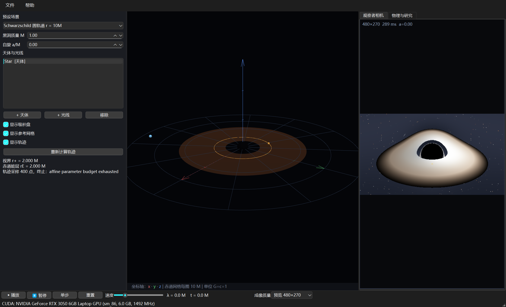
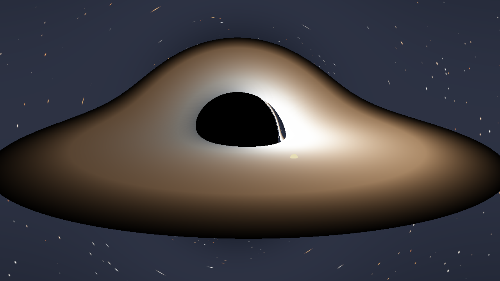

# Black Hole Simulator

[](https://en.cppreference.com/w/cpp/20)
[](https://www.qt.io/)
[](https://developer.nvidia.com/cuda-toolkit)
[](LICENSE)

一个固定在 Kerr 背景时空中的交互式三维实验室：放置测试天体与光线，积分它们的测地线，
同时用三维轨迹视图和观察者相机视图呈现结果。



*左：场景设置　中：三维轨迹视图　右：观察者相机 / 物理与研究*

观察者相机视图中的黑洞阴影**由逐像素反向追踪零测地线计算得到**，不是贴上去的黑色圆盘。



## 特性

- **Kerr / Schwarzschild 背景**：Kerr-Schild 笛卡尔坐标，视界处无坐标奇性，光线可直接穿过视界积分
- **统一运动方程**：`H = ½ g^{μν} p_μ p_ν`，解析导数，Dormand–Prince 5(4) 自适应积分
- **测试粒子与光线**：局部 ZAMO 标架给初条件，守恒量 `E`、`L_z`、Carter `Q`、`2H` 全程监测
- **GPU 观察者成像**：CUDA 反向光线追踪，含薄盘、多普勒/红移、背景星场与引力透镜
- **交互式三维视图**：旋转缩放、视界/能层/吸积盘、带刻度的坐标轴
- **自定义初条件**：按 Boyer–Lindquist 坐标放置天体与光子，对话框内实时预览轨迹命运
- **实验管理**：8 个预设场景、JSON 存档、轨迹 CSV 与图像 PNG 导出
- **单文件安装包**：Inno Setup 打包，无需额外运行库

## 快速开始

从 [Releases](../../releases) 下载 `BlackHoleSimulator_Setup.exe` 安装，或直接运行
`dist\BlackHoleSimulator.exe`（便携版，整个目录可拷贝）。

从源码构建见 [docs/BUILD.md](docs/BUILD.md)。

## 使用

完整说明见 [docs/USER_GUIDE.md](docs/USER_GUIDE.md)。五分钟上手：

1. 启动，默认场景是 Schwarzschild 圆轨道 r = 10M
2. 点底部 **▶ 播放**，看天体沿轨迹运动
3. 切到 **观察者相机** 标签页，拖动鼠标转视角，看阴影与星场被透镜扭曲
4. 把 **自旋 a/M** 改成 0.9，看轨道面进动、阴影变形
5. 切到 **物理与研究** 标签页，确认 Carter Q 的漂移曲线是平的
6. **文件 → 导出图像 PNG** 保存当前画面

## 物理约定

| 项目 | 约定 |
|---|---|
| 单位 | `G = c = 1`，长度与时间以 `M` 为单位 |
| 号差 | `(-, +, +, +)` |
| 坐标 | Kerr-Schild 笛卡尔 `(t, x, y, z)` |
| 有质量粒子 | `2H = -m²` |
| 光线 | `H = 0` |
| CPU 积分 | Dormand–Prince 5(4) 自适应，`rtol = 1e-9` |
| GPU 积分 | 四阶 Runge–Kutta，`h ≈ 0.03(1+r)`，FP32 |

## 验收测试

```bat
build\bh_tests.exe
```

覆盖 20 项，全部通过：

| 测试 | 结果 |
|---|---|
| `g^{μν} g_{νλ} = δ`（a = 0 / 0.5 / 0.9） | 误差 2e-16 |
| 解析导数 vs 中心差分 | 9e-11 |
| Schwarzschild 圆轨道 r = 10M | 半径漂移 4e-9，E、L_z 与解析值一致 |
| Kerr 倾斜轨道 Carter 常数 | 相对漂移 4e-11 |
| 光子球 r = 3M | 保持在光子球 |
| 临界碰撞参数 | 5.196152 = 3√3 |
| 弱场偏折 b = 50M | 0.085083 vs 理论 0.084712 |
| 场景 JSON 往返 | 通过 |

## 性能

RTX 3050 6GB Laptop，FP32，`maxSteps = 6000`：

| 分辨率 | 耗时 |
|---|---|
| 480×270 | ~0.2 s |
| 800×450 | ~0.5 s |
| 1280×720 | ~1.1 s |

## 范围与限制

**已实现**：固定 Kerr 背景、无自旋测试粒子、零测地线、薄盘示意、观察者成像、守恒量监测、
预设/存档/导出。

**未实现**（见 [docs/SPEC.md](docs/SPEC.md) 的原始需求）：

- 候选守恒量的导入与符号残差验证
- 批量参数扫描
- 带电粒子（Kerr–Newman 背景）
- 偏振平行移动
- Maxwell 波动模块

此外：GPU 光线追踪用 FP32 固定步长，精度低于 CPU 轨迹，定量结论请以守恒量漂移为准；
相机不能进入 `1.35 r₊` 以内；成像为单帧快照，无运动模糊。

## 目录结构

```
src/core/       物理内核：度规、积分器、场景模型、预设
src/imaging/    CUDA 光追内核 + 纯 CPU 参考实现
src/ui/         Qt 界面、OpenGL 三维视图、相机视图、研究面板
src/app/        程序入口
tests/          物理验收测试
tools/          构建脚本与命令行渲染器
docs/           需求、构建、实现、使用说明
```

## 文档

- [需求规格](docs/SPEC.md)
- [构建说明](docs/BUILD.md)
- [实现说明与验收结果](docs/IMPLEMENTATION.md)
- [使用手册](docs/USER_GUIDE.md)

## 许可

MIT，见 [LICENSE](LICENSE)。
